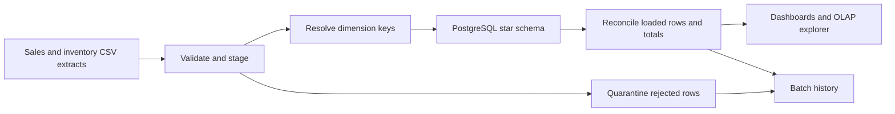

# Retail Analytics · SEG4105 Group 14

A PostgreSQL warehouse and web application for analyzing retail sales and inventory. The dashboard, OLAP explorer, and batch worker follow the Group 14 proposal and design deliverables.

## Project at a glance

- **Overview and inventory** show sales totals, stock on hand, and reorder exceptions by date, store, or product.
- **OLAP explorer** supports drill-down, roll-up, and pivots across the warehouse dimensions.
- **Administration** shows batch reconciliation and account settings for authorized users.

The demo runs on synthetic data. Start with [Run the demo](#run-the-demo), then follow the [dashboard walkthrough](#dashboard-walkthrough) to verify those workflows.

## Documentation

- [Software Components](docs/COMPONENTS.md)
- [System Architecture](docs/ARCHITECTURE.md)
- [Development Methodology](docs/METHODOLOGY.md)

## Run the demo

From the repository root, with Docker Compose and Python 3 available:

```sh
./scripts/configure-demo.sh
docker compose up -d --build --wait
awk '/^OLAP_BOOTSTRAP_(ADMIN|MANAGER)_PASSWORD=/' .env
```

Open [Retail Analytics](http://127.0.0.1:8014). The setup script stores generated passwords for `manager` and `admin` in the git-ignored `.env` alongside the database credentials. Demo data covers November 1, 2023 through November 1, 2026, with the last sales day on October 31, 2026 and a closing inventory snapshot on November 1.

Run `docker compose stop` to stop the services and keep the warehouse. Run `docker compose up -d --wait` to resume. If you lose access to the admin account, create a second administrator with `docker compose run --rm bootstrap python -m olap user recovery-admin --role admin`, then reset the original account under **Administration**.

### Verify a Docker Hub image

Use a fresh checkout on a machine with Docker Compose and Python 3. Replace `YOUR_NAMESPACE/seg4105-group14-olap` with the published image name. On a machine with the demo already running on port 8014, use another port such as `OLAP_PORT=8015` and update the health-check URL accordingly.

```sh
./scripts/configure-demo.sh
export OLAP_IMAGE=YOUR_NAMESPACE/seg4105-group14-olap:latest
docker compose -p olap-pull-check -f compose.yaml -f compose.image.yaml pull
docker compose -p olap-pull-check -f compose.yaml -f compose.image.yaml up -d --no-build --wait
curl --fail --show-error http://127.0.0.1:8014/healthz
docker compose -p olap-pull-check -f compose.yaml -f compose.image.yaml down
```

The override uses the same image for `bootstrap`, `app`, and `worker`. PostgreSQL still comes from `postgres:16`. A successful health check returns `{"status":"ready"}`. Sign in as `manager` and open the dashboard to verify the seeded data. For Lab 8, retain the Docker Hub tag listing and the successful pull and run output. Never include the generated `.env` credentials in screenshots.

### Run with local PostgreSQL

Create a dedicated database owned by your local PostgreSQL account. The following uses the same local database connection for setup, ETL, and the web process. Compose uses separate runtime database roles.

```sh
python3 -m venv .venv
. .venv/bin/activate
pip install -r requirements.txt
createdb olap
export DATABASE_URL=postgresql:///olap
export OLAP_DEMO=true
python -m olap init --demo
python -m uvicorn olap.app:app --host 127.0.0.1 --port 8014
```

In a second terminal, run `python -m olap worker` with the same environment if you want to process new extracts automatically.

## Dashboard walkthrough

| Screen | Try this |
| --- | --- |
| **Overview** | Review net sales, units sold, closing stock, and reorder exceptions. Apply a date or region filter to slice the view. Select multiple regions and categories to dice it. Use the sales trend's monthly values or open a category to see its products. |
| **Inventory** | Change the end date to inspect an earlier snapshot. The application uses the latest recorded inventory date in the selected range for every store and product in the selection. A position is below reorder when its on-hand quantity is strictly below its reorder point. |
| **OLAP explorer** | Choose a measure and row dimension. For sales, drill from year to quarter, month, and day. Both datasets support region to store and category to product. Use **Roll up** to restore the prior scope. Add a column dimension to pivot, then **Swap axes** to transpose. Inventory pivots use one snapshot. |
| **Administration** | Sign in as an admin to review load history, source counts, reconciliation, and rejected-row counts. Create accounts, change roles, disable access, or reset passwords. Managers can use all analytics screens. |

Sales are in CAD, the calendar is Gregorian, and percentage changes compare with the immediately preceding period of the same length. Product and store dimensions use Type 1 updates. Reporting uses the latest names and classifications.

## Daily extracts and reconciliation



The fact grains are one sales transaction line and one inventory snapshot per date, store, and product. Both facts share the date, product, and store dimensions. See [schema.sql](sql/schema.sql) for constraints and indexes and [example_queries.sql](sql/example_queries.sql) for the adapted queries supplied with the design.

For real extracts, set `OLAP_DEMO=false` before initializing a fresh database. Place each batch under `data/inbox/<batch-id>/`. Use lexically sortable IDs such as `2026-11-21-001` so corrections and updates apply in order. Each batch needs these UTF-8 CSVs, with headers even for files with no rows.

| File | CSV columns |
| --- | --- |
| `products.csv` | `product_id,product_name,category` |
| `stores.csv` | `store_id,store_name,region` |
| `sales.csv` | `sales_line_key,date,store_id,product_id,quantity_sold,net_sales_amount` |
| `inventory.csv` | `date,store_id,product_id,stock_on_hand,reorder_point` |

Provide dates as `YYYY-MM-DD`, globally unique positive integer sales line keys, nonnegative quantities and stock, and nonnegative CAD net amounts with at most two decimal places. Either include dimension records or reference IDs already in the warehouse. Make the drop readable by the worker and create an empty `READY` file when all files are complete. If files may arrive concurrently, publish the completed directory with an atomic rename.

- The worker checks the inbox every 15 minutes. Supply both daily extracts from the source systems to meet the refresh target. The dashboard reports freshness for each feed and flags an overdue load after 24 hours.
- Each load records extraction, acceptance, rejection, timing, and reconciliation. Invalid rows are quarantined in `etl_reject` with their source file, line, and reason. The accepted rows and audit results commit together after reconciliation. The stock reconciliation total sums source rows solely to check loading accuracy.
- The worker skips completed batch IDs, retries transient errors, and pauses later loads behind a failed batch. Fix a failed batch in place. For a completed load with rejected rows or data corrections, submit those rows with a new batch ID. Fact keys make reprocessing an idempotent upsert.
- Compose gives the ETL worker a read-only source mount and its own warehouse write role. The application uses a separate database role with read access to warehouse facts and write access to accounts and sessions. When serving through an HTTPS reverse proxy, set `OLAP_COOKIE_SECURE=true`.

For an immediate run, use `docker compose exec worker python -m olap worker --inbox /incoming --once`. For a local PostgreSQL setup, use `python -m olap load path/to/batch`.

## Verification and project acceptance

Run the PostgreSQL integration tests with an account that can create a temporary schema. They cover known sales and inventory totals, pivot and transpose, filter intersections, replay, quarantine, failure recovery, and API role controls.

```sh
pip install pytest httpx
OLAP_TEST_DATABASE_URL=postgresql:///olap python -m pytest -q
python scripts/benchmark.py --users 100
```

The benchmark prompts for the dashboard password and measures each standard analytics endpoint with 100 independently authenticated sessions on the seeded dataset. It exits unsuccessfully if a request fails or exceeds five seconds.

| Design criterion | How to verify |
| --- | --- |
| SC-01 / SC-02 · Five seconds and 100 concurrent users | Run the benchmark on the target hardware and approved dataset. |
| SC-03 · Daily refresh | Deliver both daily source extracts and review timestamps and batch history in the deployed environment. |
| SC-04 · 99.5% availability | Measure `/healthz` and an authenticated dashboard journey over the agreed monitoring window. |
| SC-05 · Three years of history | The demo covers three years. Verify real source coverage before acceptance. |
| SC-06 · Reconciliation and UAT | The ETL checks accepted rows against the warehouse. Have the business representative validate the KPIs and sign off on the dashboard workflows. |

The supplied [Monte Carlo model](scripts/OLAP_Schedule_Monte_Carlo.py) remains a project schedule deliverable. Run it with `pip install numpy matplotlib` and `python scripts/OLAP_Schedule_Monte_Carlo.py`. Its seeded 200,000 trials reproduce the design's 13.19-week mean and 14.15-week P80.
