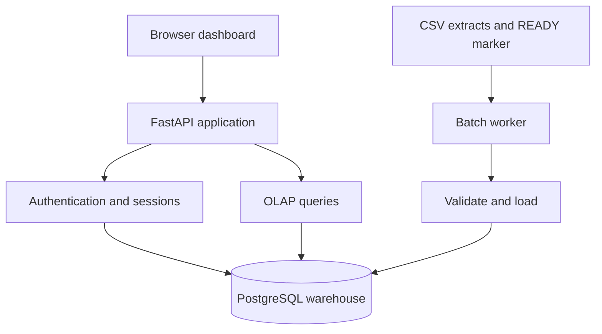

# System Architecture

The platform uses a layered application and a separate batch worker. PostgreSQL stores the analytical warehouse, application accounts, sessions, and ETL audit records.

## 1. Architectural Style

The web application is a modular monolith. FastAPI serves the browser assets and HTTP endpoints from one application. Authentication, analytical queries, and database access are separate Python modules. The ETL worker runs as a separate process using the same Python codebase.

This structure keeps a small student project manageable. The worker can process extracts without making a browser request wait for a batch load. SQL performs the aggregations close to the warehouse data. PostgreSQL remains a shared dependency for both processing and reporting.

## 2. Component Interaction Diagram

In Docker Compose, four services support this design.

| Service | Role | Startup dependency |
| --- | --- | --- |
| `db` | Run PostgreSQL 16 and persist data in the `warehouse` volume. | Database health check |
| `bootstrap` | Initialize the schema, runtime database roles, and initial accounts. Load synthetic extracts when demo mode is enabled. | Healthy `db` |
| `app` | Serve the UI and API on container port 8000, mapped to host port 8014 by default. | Successful `bootstrap` |
| `worker` | Poll the read-only incoming extract mount and load completed batches. | Successful `bootstrap` |

The service configuration is in [`compose.yaml`](../compose.yaml). The [README](../README.md#run-the-demo) gives the startup commands.

## 3. Data Flow and Execution Lifecycle

### Batch ingestion

1. The source systems supply four CSV extracts in a batch directory. The producer adds `READY` only after the files are complete. Sortable batch IDs establish processing order.
2. The worker checks the inbox every 900 seconds by default. It skips completed batch IDs and pauses later batches behind a failed batch.
3. The ETL loader validates required fields, types, quantities, amounts, and identifiers. It records rejected rows and resolves accepted records to warehouse dimension keys.
4. Dimensions are loaded before facts. Upserts and fact constraints support repeatable loading. A database advisory lock serializes batch loads.
5. The loader reconciles accepted records against warehouse counts and amounts before the data transaction commits. A failure rolls back that transaction and records a failed run. Transient database failures are retried up to three attempts.
6. Administrators inspect recent run results through the application. Freshness information identifies feeds whose latest fact date is more than 24 hours old. Meeting the daily refresh target also requires timely delivery of source extracts.

### Reporting requests

1. A manager or administrator signs in. The server verifies the password and sets an HttpOnly, SameSite Strict session cookie. PostgreSQL stores the token's hash and expiry.
2. The browser sends date and dimension filters to the API. The server validates the account, role, dates, dimensions, and measure.
3. The analytics module builds queries from fixed dimension/measure mappings and passes filter values as SQL parameters.
4. Sales queries aggregate transaction lines. Inventory queries first choose the latest snapshot date in the selected range, then apply store and product filters to that snapshot. Inventory balances are not summed across dates.
5. Read-only transactions return a consistent query result. The API sends JSON to the dashboard, which updates its KPIs, charts, and pivot tables.

### Storage and access

- `fact_sales` has one row per sales transaction line. `fact_inventory_snapshot` has one row per date, store, and product.
- `dim_date`, `dim_product`, and `dim_store` are shared dimensions. Product and store updates use the latest supplied attributes.
- The Compose web database role can read warehouse data and manage application accounts/sessions. The ETL role can write warehouse and audit records. Initialization uses the owner role.
- The app and worker use the same database service. The persistent volume preserves data when services stop. Production HTTPS deployments must enable secure cookies with `OLAP_COOKIE_SECURE=true`.

## 4. Architecture Decision Records

These records explain decisions represented by the current implementation.

### ADR-01 Use a PostgreSQL star schema

Retail reporting needs sales and stock measures grouped by date, product, and store. Shared dimensions and two fact tables support those queries and database-level integrity checks. Aggregation performance depends on indexes, query design, and the deployed dataset.

### ADR-02 Use batch ETL with validation before loading

The scope requires daily refreshes. CSV batches with a completion marker, validation, quarantine, and reconciliation provide a traceable loading process. Reports depend on the latest delivered batch, and invalid records need follow-up.

### ADR-03 Keep the web application together and run ETL separately

One FastAPI application serves both the static frontend and API, while a separate worker processes batches. This reduces deployment complexity and separates their process lifecycles. Both still depend on the shared PostgreSQL service and codebase.

### ADR-04 Report inventory from one snapshot

Stock on hand is a balance at a particular time. Queries select one snapshot to avoid counting the same stock across several dates. Inventory pivots therefore use product/store dimensions, while time-axis inventory pivots are rejected.

### ADR-05 Use database-backed sessions and separate runtime roles

The implementation uses salted scrypt password hashes, hashed session tokens, role checks, and separate web/ETL database grants. These support account revocation and limit routine database access. Deployment still needs controlled credentials and HTTPS configuration.
  
